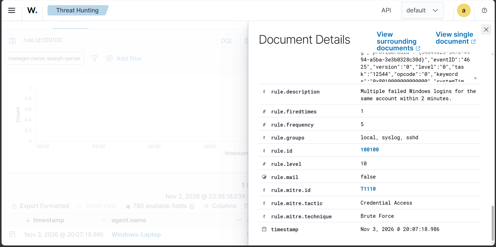
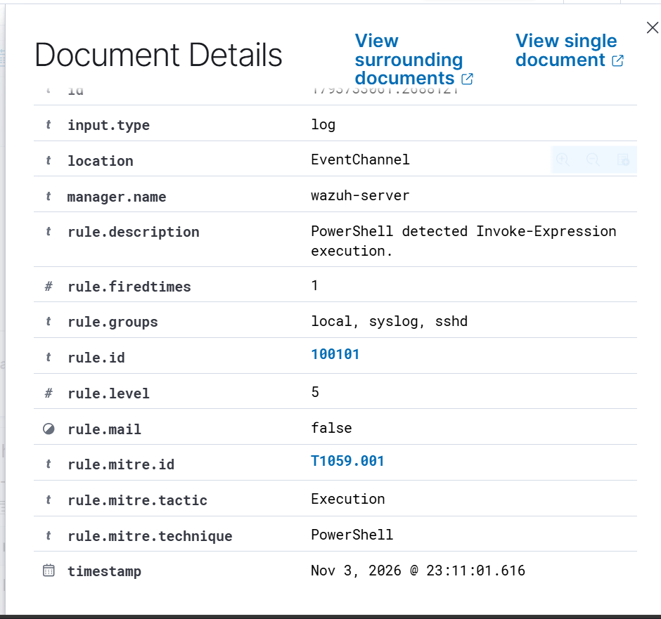

# Custom Detection Rules – Wazuh

## Overview

Custom Wazuh detection rules were developed to identify selected security activities observed on the Windows 11 endpoint.

The rules extend Wazuh's built-in detection capabilities and demonstrate basic detection engineering and security alert analysis.

## Custom Rules Summary

| Rule ID | Detection | Severity |
|:---:|:---|:---:|
| `100100` | Repeated failed login attempts | Custom |
| `100101` | PowerShell Invoke-Expression activity | 5 |

## 1. Repeated Failed Login Detection – Rule 100100

A custom rule was configured to identify repeated failed Windows authentication attempts.

**Purpose:**
- Monitor repeated unsuccessful login attempts.
- Identify potentially suspicious authentication activity.
- Support investigation of possible brute-force behaviour.

The rule was tested using controlled failed login attempts in the lab environment.

## 2. PowerShell Invoke-Expression Detection – Rule 100101

A custom detection rule was created to identify PowerShell script blocks containing `Invoke-Expression` or its alias `IEX`.

**Rule Configuration:**

| Attribute | Value |
|:---|:---|
| Rule ID | `100101` |
| Parent Rule | `91802` |
| Severity Level | `5` |
| Event ID | `4104` |
| Detection Field | `win.eventdata.scriptBlockText` |
| MITRE ATT&CK | `T1059.001` |

**Detection Logic:**

The rule uses a case-insensitive regular expression to match:

- `Invoke-Expression`
- `IEX`

**Custom Rule XML:**

```xml
<rule id="100101" level="5">
    <if_sid>91802</if_sid>
    <field name="win.eventdata.scriptBlockText" type="pcre2">(?i)(Invoke-Expression|\bIEX\b)</field>
    <description>PowerShell detected Invoke-Expression execution.</description>
    <mitre>
        <id>T1059.001</id>
    </mitre>
</rule>
```

## 3. Testing and Validation

The custom rule was tested using a controlled PowerShell script.

**Test Script:**

```powershell
$testPath = Join-Path $env:TEMP 'wazuh-iex-test.ps1'

@'
Write-Output "WAZUH-IEX-TEST"
Invoke-Expression "Get-Date"
'@ | Set-Content -Path $testPath

powershell.exe -NoProfile -File $testPath

Remove-Item $testPath
```

The command `Get-Date` was used as a harmless test command executed through `Invoke-Expression`.

**Observed Results:**

| Field | Observed Value |
|:---|:---|
| Agent | Windows-Laptop |
| Agent ID | `001` |
| Windows Event ID | `4104` |
| Custom Rule ID | `100101` |
| Alert Level | `5` |
| MITRE Technique | `T1059.001` |
| Detection Status | Successful |

The generated alert confirmed that Wazuh successfully matched the custom rule and generated the expected security event.

## 4. MITRE ATT&CK Mapping

| Technique ID | Technique | Context |
|:---:|:---|:---|
| `T1057` | Process Discovery | PowerShell process discovery activity |
| `T1082` | System Information Discovery | PowerShell system information queries |
| `T1059.001` | PowerShell | PowerShell Invoke-Expression activity |

## 5. Configuration Validation

Before restarting the Wazuh Manager, the custom rule configuration was validated using:

```bash
sudo /var/ossec/bin/wazuh-analysisd -t
```

After successful validation, the Wazuh Manager was restarted and its service status was checked.

## 6. Security Analysis

The use of `Invoke-Expression` is not inherently malicious. It is a legitimate PowerShell feature that can also be abused to execute dynamically generated commands.

Therefore, the custom rule identifies potentially interesting activity for further investigation rather than automatically classifying it as malicious.

## Outcome

Successfully developed, validated and tested a custom Wazuh PowerShell detection rule.

This exercise provided practical experience with:
- Wazuh XML rule configuration.
- Parent-child rule relationships.
- PowerShell Script Block Logging.
- Regular expression-based event matching.
- MITRE ATT&CK mapping.
- Security alert validation and investigation.

## Detection Testing and Evidence

Both custom detection rules were tested using controlled activities on the Windows endpoint.

### Rule 100100 – Multiple Failed Windows Logins

- Generated multiple failed login attempts for the same Windows account.
- Verified that Wazuh triggered the custom rule.
- Confirmed severity level 10 and MITRE ATT&CK technique T1110.



### Rule 100101 – PowerShell Invoke-Expression Detection

- Executed a controlled PowerShell test using Invoke-Expression.
- Verified that Wazuh detected the PowerShell script block.
- Confirmed severity level 5 and MITRE ATT&CK technique T1059.001.



### Testing Note

These tests were performed in a controlled lab environment. Detection of Invoke-Expression alone does not establish malicious activity; further investigation and contextual analysis are required.
