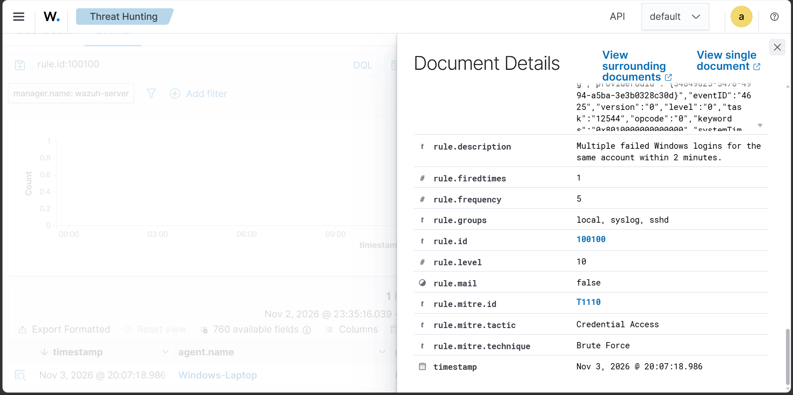
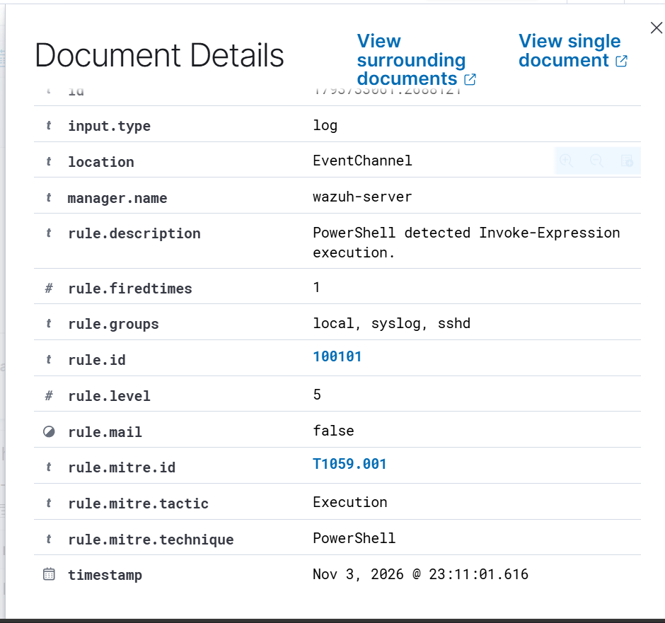

# Wazuh SIEM Home Lab – Security Monitoring & Detection Engineering

## 📌 Project Overview

This project demonstrates the deployment and configuration of a **Security Information and Event Management (SIEM)** environment using **Wazuh** and **Windows 11**.

The lab focuses on endpoint security monitoring, Windows event log analysis, PowerShell activity monitoring, custom detection rule development, and security alert investigation.

The objective is to gain practical experience with SIEM operations and develop foundational Security Operations Center (SOC) Analyst skills.

---

## 🖥️ Lab Environment

| Component | Configuration |
|:---|:---|
| SIEM Platform | Wazuh |
| Deployment | Wazuh OVA |
| Virtualization | Oracle VirtualBox |
| Endpoint | Windows 11 |
| Endpoint Agent | Wazuh Windows Agent |
| Log Collection | Windows EventChannel |
| Monitoring | Windows Security & PowerShell Operational Logs |

---

## 🏗️ Lab Architecture

The lab consists of a Wazuh Manager running inside a VirtualBox virtual machine and a Windows 11 endpoint connected through the Wazuh Agent.

**Monitoring Workflow:**

```text
Windows 11 Endpoint
        |
        v
   Wazuh Agent
        |
        v
  Wazuh Manager
        |
        v
 Wazuh Dashboard
```

---

## 🔍 Implemented Features

### 1. SIEM Deployment & Endpoint Integration

- Deployed Wazuh using its official virtual machine image.
- Configured the Wazuh Manager and Dashboard.
- Integrated a Windows 11 endpoint using the Wazuh Agent.
- Verified communication between the endpoint and SIEM server.

### 2. Windows Security Event Monitoring

Monitored and investigated Windows Security Events:

| Event ID | Description |
|:---:|:---|
| `4624` | Successful logon |
| `4625` | Failed logon |

Investigated authentication activity and examined relevant event fields to understand login behaviour.

### 3. PowerShell Activity Monitoring

- Enabled PowerShell Script Block Logging through Windows policy configuration.
- Integrated the `Microsoft-Windows-PowerShell/Operational` event channel with Wazuh.
- Monitored PowerShell Script Block Logging events (Event ID `4104`).
- Verified that script content was successfully collected and indexed in Wazuh.

### 4. Custom Detection Rule Development

Developed and tested custom Wazuh detection rules.

| Rule ID | Detection | Severity |
|:---:|:---|:---:|
| `100100` | Repeated failed login attempts | Custom |
| `100101` | PowerShell Invoke-Expression activity | 5 |

**Custom Rule 100101:**

- Detects `Invoke-Expression` and its `IEX` alias in PowerShell script block events.
- Uses Wazuh rule `91802` as its parent.
- Generates a custom alert at severity level 5.
- Maps the detection to MITRE ATT&CK technique `T1059.001` – PowerShell.

### 5. MITRE ATT&CK Mapping

| Technique ID | Technique | Detection Context |
|:---:|:---|:---|
| `T1057` | Process Discovery | PowerShell `Get-Process` activity |
| `T1082` | System Information Discovery | PowerShell system environment queries |
| `T1059.001` | PowerShell | PowerShell `Invoke-Expression` activity |

---

## 🛠️ Technologies & Tools

- **SIEM:** Wazuh
- **Operating System:** Windows 11
- **Virtualization:** Oracle VirtualBox
- **Scripting:** PowerShell
- **Log Analysis:** Windows Event Logging
- **Detection Rules:** XML
- **Framework:** MITRE ATT&CK

---

## 📚 Key Learning Outcomes

- SIEM deployment and configuration.
- Endpoint integration and centralized log collection.
- Windows Security Event investigation.
- PowerShell Script Block Logging.
- Custom detection rule development.
- Security alert analysis and MITRE ATT&CK mapping.
- Troubleshooting SIEM services and agent connectivity.

---

## 📸 Screenshots

## Detection Evidence

### 1. Multiple Failed Windows Logins

Custom Rule ID: `100100`  
Severity: Level 10  
MITRE ATT&CK: T1110 – Brute Force



### 2. PowerShell Invoke-Expression Detection

Custom Rule ID: `100101`  
Severity: Level 5  
MITRE ATT&CK: T1059.001 – PowerShell


---

## 🚀 Future Improvements

- Expand custom detection rules.
- Investigate additional Windows security events.
- Develop more advanced threat detection scenarios.
- Explore alert correlation and incident response workflows.

---

## ⚠️ Disclaimer

This project was developed in a controlled home lab environment for educational and cybersecurity skill-development purposes.

All detection tests were performed using controlled, benign commands and activities.
